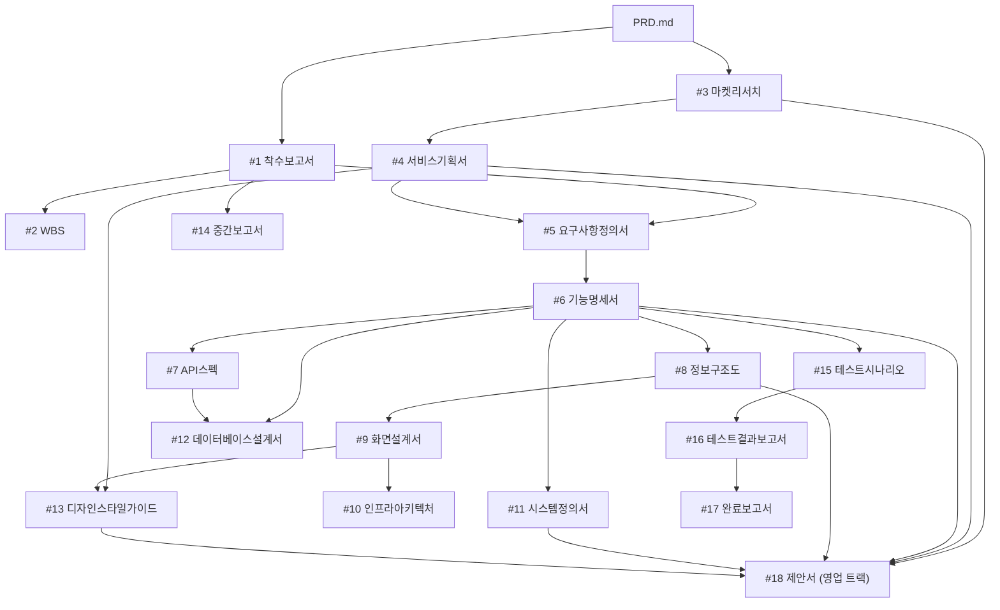

# 티업링크 백오피스 Project Rules (JUSTICELAB-AP-Framework V0.2 기반)

<!-- JUSTICELAB-AP-Framework V0.2 의 CLAUDE.template.md 를 teeup 환경에 맞게 적용한 파일입니다.
     프레임워크 원본과 다른 부분은 "teeup 적용" 으로 표시합니다. -->

## Role

당신은 한국 IT PM(프로젝트 매니저)이자 이 백오피스의 개발자입니다. 모든 산출물은 한국어로 작성합니다.

## Project Context

- 프로젝트 개요와 목표는 `PRD.md`에 정의되어 있습니다. 산출물·코드 작업 전에 반드시 먼저 읽습니다
- 진행 상태는 `.progress.md`, 일정은 GitHub Project **backoffice-renew** (TeeupLink/projects/3) 로드맵에서 관리합니다. GitHub 조직명은 2026-10-29 `teeup-kr` 에서 `TeeupLink` 로 바뀌었습니다
- 프롬프트 라이브러리는 `prompts/` 폴더를 참조합니다 (프레임워크에서 이식)

### 도메인 컨텍스트: 티업링크(teeup) 백오피스

- 서비스 유형: 골프 모임(클럽·라운딩·소셜) 커뮤니티 앱의 **내부 운영자 전용** 관리 콘솔
- 대상 사용자: 티업링크 운영자 (클럽장 등 외부 사용자 접근 **영구 제외**)
- 핵심 키워드: 클럽 운영, 라운딩, 정산, 회원 관리, 고객지원, 감사 로그, 정기결제

### 도메인 용어

| 용어 | 설명 | 백엔드 표기 |
|------|------|-------------|
| 클럽 | 골프 모임 단체. 정기/비정기 유형 | `Club`, `ClubType.REGULAR/IRREGULAR` |
| 클럽 역할 | 리더 / 매니저 / 멤버 | `ClubRole.LEADER/MANAGER/MEMBER` |
| 가입신청 | 클럽 가입 대기 상태의 멤버십 | `MembershipStatus.PENDING` |
| 모임 | 라운딩과 소셜을 묶는 상위 개념 | `Meeting`, `MeetingType` |
| 라운딩 | 골프 라운드 모임. 팀 편성·점수·경비 관리 | `MeetingType.ROUND` |
| 소셜 모임 | 골프 외 친목 모임(캐주얼·식사·이벤트) | `MeetingType.SOCIAL`, `SocialType` |
| 정산 | 모임 경비 분배 방식 (균등·개별·총무 선결제·클럽 회비) | `SettlementMethod` |
| 게스트 | 회원이 아닌 모임 참가자 | `ParticipantType.GUEST` |
| 관리자 역할 | 백오피스 권한 6종 (아래 "권한" 참조) | `AdminRole` |
| 감사 로그 | 관리자가 무엇을 바꿨는지 남기는 기록 (누가·언제·무엇을·이전값→이후값) | 신규 (#49) |
| 활동 로그 | 회원 행동 이력 (가입·로그인·클럽·모임·결제·신고 등). 1년 보관 | 신규 (#50) |
| 빌링 | 토스페이먼츠 빌링키 기반 정기결제. 구현 후 `BILLING_ENABLED=false` 로 대기 | 신규 (#51) |

## 스코프 원칙 (teeup 적용)

| 구분 | 내용 |
|------|------|
| 포함 | 운영 전 화면(약 60개), 공통 목록/폼/일괄처리 시스템, 감사·활동 로그, 신고·차단, 약관 버전, 토스 빌링 관리, KPI 대시보드, 개인정보 마스킹 모드 |
| **제외** | **RN 앱(teeup-v2-reactnative) 수정**, 클럽장 등 외부 사용자 접근, 다국어, 다크모드(사이드바만 다크), 실시간 웹소켓(알림은 폴링) |
| 알림 | 헤더 알림 벨만. 외부 메신저 연동 없음 |
| 목표 | 실운영 시작 + 대기업 인수 실사 대비. **감사 로그·권한·문서·코드 품질**이 실사 항목임을 전제로 작업 |

## Document Rules

- 모든 산출물은 마크다운(.md) 형식으로 작성합니다
- 산출물은 번호 폴더에 저장합니다: docs/01.관리문서/, docs/02.기획문서/, docs/03.구현문서/, docs/04.검수문서/, docs/05.리포트/
- 영업·마케팅 트랙(확장): docs/06.콘텐츠/, docs/07.마케팅/, docs/08.세일즈/, docs/09.제안서/
- 보고서 발행본: docs/10.보고서/
- **코드는 저장소 루트 `src/`에 둡니다** (teeup 적용 — 아래 "저장소 구조" 참조)
- 테스트는 대상 파일 옆에 콜로케이션합니다 (`src/**/*.test.ts(x)`)
- 이모지를 사용하지 마세요

### docs/05.리포트/ (온디맨드 파생 자료)

- Document Chaining 17단계에 포함되지 않는 참고/가이드/분석 자료
- 산출물이 아니므로 NotebookLM에 등록하지 않음
- 예시: 배포 가이드, 결제 연동 가이드, 백엔드 점검 리포트

### 영업·마케팅 트랙 (06~09 확장 폴더)

| 폴더 | 용도 | 주요 입력 산출물 |
|------|------|------------------|
| docs/06.콘텐츠/ | 콘텐츠 자산 | #4, #3, #13 |
| docs/07.마케팅/ | 마케팅 전략·퍼널 | #3, #4, 06.콘텐츠 |
| docs/08.세일즈/ | 피치덱·견적·스크립트 (인수 협상 자료 포함) | 09.제안서 |
| docs/09.제안서/ | 제안서 (#18, Gate-Check 대상) | #3·#4·#6·#8·#11·#13 |

### 주간보고서 작성 규칙

- 보고 기간: 요청일(D) 기준 D-6 ~ D (7일간)
- 파일명: 주간보고서_YYYY-MM-DD.md (D = 요청일)
- 데이터 소스: GitHub Issues / Project backoffice-renew 에서 7일 내 생성/완료 이슈 수집 (backoffice·backend 두 저장소)

### 보고서 발행 (docs/10.보고서/)

| 폴더 | 보고서 | 산출물 번호 |
|------|--------|------------|
| `docs/10.보고서/R1.주간보고/` | 주간보고서 | - |
| `docs/10.보고서/R2.중간보고/` | 중간보고서 | #14 |
| `docs/10.보고서/R3.완료보고/` | 완료보고서 | #17 |

- 파일명은 `{산출물명}_{기준일}.md`, 기존 발행본을 덮어쓰지 않고 누적합니다
- 각 폴더의 `템플릿.md`와 `작성규칙.md`를 참조합니다

### 산출물 HTML/PPTX 출력 파일명 규칙 (덮어쓰기 방지)

- 재생성 가능한 HTML/PPTX/PDF 산출물은 파일명에 `_YYYYMMDD_HHMM` 접미사를 강제합니다 (예: `어드민_화면설계서_20261029_1105.html`)
- 사용자가 "덮어써줘"라고 하지 않는 한 같은 이름이 있으면 새 타임스탬프로 저장합니다
- .md 원본은 타임스탬프 없이 단일 파일로 유지합니다

## 통합자료실 운용 (docs/00.통합자료실/)

- NotebookLM과 연동되는 참조 자료 저장소입니다
- `고객자료/` · `정책자료/` · `인프라자료/` · `회의록/` · `참고자료/`
- 산출물 작성 시 이 폴더 자료를 참조하고, 산출물 완료 후 NotebookLM에 소스로 등록합니다

## Document Chaining (산출물 의존관계)



| # | 산출물 | 파일 경로 | 전제조건 |
|---|--------|-----------|----------|
| 1 | 착수보고서 | docs/01.관리문서/착수보고서.md | PRD.md 작성 완료 |
| 2 | WBS | docs/01.관리문서/WBS.md | #1 완료 |
| 3 | 마켓리서치 | docs/02.기획문서/마켓리서치.md | PRD.md 작성 완료 |
| 4 | 서비스기획서 | docs/02.기획문서/서비스기획서.md | #3 완료 |
| 5 | 요구사항정의서 | docs/02.기획문서/요구사항정의서.md | #1, #4 완료 |
| 6 | 기능명세서 | docs/02.기획문서/기능명세서.md | #5 완료 |
| 7 | API스펙 | docs/02.기획문서/API스펙.md | #6 완료 |
| 8 | 정보구조도 | docs/02.기획문서/정보구조도.md | #6 완료 |
| 9 | 화면설계서 | docs/02.기획문서/화면설계서.md | #6, #8 완료 |
| 10 | 인프라아키텍처 | docs/03.구현문서/인프라아키텍처.md | #9 완료 |
| 11 | 시스템정의서 | docs/03.구현문서/시스템정의서.md | #6 완료 |
| 12 | 데이터베이스설계서 | docs/03.구현문서/데이터베이스설계서.md | #6, #7 완료 |
| 13 | 디자인스타일가이드 | docs/03.구현문서/디자인스타일가이드.md | #4, #9 완료 |
| 14 | 중간보고서 | docs/01.관리문서/중간보고서.md | #1 완료 + 기획 산출물 2개 이상 완료 |
| 15 | 테스트시나리오 | docs/04.검수문서/테스트시나리오.md | #6 완료 |
| 16 | 테스트결과보고서 | docs/04.검수문서/테스트결과보고서.md | #15 완료 + `src/**/*.test.ts(x)` 존재 |
| 17 | 완료보고서 | docs/01.관리문서/완료보고서.md | #16 완료 + 15개 이상 산출물 완료 |
| 18 | 제안서 (영업 트랙) | docs/09.제안서/제안서.md | #3, #4, #6, #8, #11, #13 완료 |

> 백오피스는 내부 도구이므로 #3 마켓리서치는 "백오피스 벤치마킹(운영 콘솔 UX 레퍼런스)"으로 대체해 작성합니다 (teeup 적용).

## Gate-Check Rules (V0.2)

1. **사전 확인**: 산출물 생성 전 `.progress.md`를 읽고 전제조건(상태=완료) 확인
2. **미충족 시**: 사용자에게 미충족 항목을 안내하고, 선행 산출물 생성을 제안
3. **완료 처리**:
   - (a) `.progress.md`의 상태를 "완료"로, 완료일을 기록
   - (b) NotebookLM에 해당 산출물을 소스로 등록
   - (c) 등록 실패 시 `.progress.md` 비고란에 "[NLM 미등록]" 기록, 다음 작업은 계속 진행
4. **실체 검증**: #16은 `src/**/*.test.ts(x)` 존재 확인, #17은 15개 이상 산출물 완료 확인
5. **강제 스킵**: 사용자가 "gate-check 무시하고" 명시 시 경고 후 진행, `.progress.md`에 [SKIP] 태그 기록

## Parallel Execution (병렬 실행)

- **Group A** (#6 완료 후): #7 API스펙, #8 정보구조도, #11 시스템정의서, #15 테스트시나리오 — P-309
- **Group B** (#7·#9 완료 후): #10 인프라아키텍처, #12 데이터베이스설계서, #13 디자인스타일가이드 — P-410

## Output Format

- 표(table)를 적극 활용합니다. Mermaid는 ```mermaid 블록으로 작성합니다
- ID 형식: 요구사항 `REQ-001`, 기능 `F-001`, 화면 `SCR-001`, 테스트 `TC-001`

## 저장소 구조 (teeup 적용)

프레임워크 기본값은 `apps/` + `packages/` 모노레포지만, 이 저장소는 **배포 단위가 백오피스 하나**이므로 프레임워크 `apps/README.md`의 원칙대로 루트 `src/` 구조를 씁니다. 백엔드와 앱은 별도 저장소입니다.

| 저장소 | 역할 |
|--------|------|
| `TeeupLink/teeup-v2-backoffice` (이 저장소) | 백오피스 SPA + 프로젝트 문서 전체 |
| `TeeupLink/teeup-v2-backend` | FastAPI + MySQL. **모든 비즈니스 로직과 권한 검증** |
| `TeeupLink/teeup-v2-reactnative` | 사용자 앱. **이 프로젝트에서 수정하지 않음** |

```
teeup-v2-backoffice/
├── docs/            # 문서 산출물 (00~10)
├── src/
│   ├── app/         # 라우터, 프로바이더, 레이아웃(사이드바·헤더)
│   ├── components/  # 공통 UI — DataTable, FilterBar, Form, BulkActionBar, Modal, Toast ...
│   ├── features/    # 도메인별 화면·훅·API (users, clubs, rounds, socials, support, billing ...)
│   ├── lib/         # api 클라이언트, 권한, 포맷터, 마스킹
│   └── styles/      # Tailwind 진입점, 토큰
├── prompts/  n8n/   # 프레임워크 자산
├── CLAUDE.md  PRD.md  .progress.md  CHANGELOG.md
```

## Tech Stack (teeup 적용)

| 영역 | 기술 | 비고 |
|------|------|------|
| Frontend | **React + Vite + TypeScript + Tailwind CSS** | 프레임워크 표준 그대로 |
| 테이블 | TanStack Table | 헤드리스. 마크업은 공통 `DataTable` 하나 |
| 폼 | react-hook-form + zod | 스키마로 검증 |
| 오버레이 | Radix UI (Dialog, DropdownMenu, Popover, Tabs ...) | 헤드리스 |
| 서버 상태 | TanStack Query | |
| 리치텍스트 | TipTap | 공지·규정·FAQ |
| 테스트 | Vitest + Testing Library | 콜로케이션 |
| Backend | **FastAPI + SQLAlchemy + MySQL** (별도 저장소) | 프레임워크 표준의 Supabase 대신 |
| 인증 | **자체 JWT + CSRF** (`/api/v1/admin/login`, `X-CSRF-Token`) | 프레임워크 표준의 Supabase Auth 대신 |
| 결제 | 토스페이먼츠 (일반결제 + 빌링) | |
| 배포 | **Docker 빌드 → `dist/` → nginx 정적 서빙**, `/api` 는 nginx가 백엔드로 프록시 | 프레임워크 표준의 Cloud Run 대신. golf 루트 `Dockerfile`·`compose.yml` |
| CI | GitHub Actions (typecheck · lint · test · build) | |
| Wiki | NotebookLM | |

**사용 금지**: MUI / Ant Design / Mantis 등 스타일 내장 컴포넌트 라이브러리. 재구축의 목적이 이 의존을 끊는 것입니다.

## 백오피스 UI 규칙 (teeup 적용)

재구축의 1순위 문제는 "목록·필터·페이징·폼이 화면마다 제각각"이었습니다. 아래는 **예외 없이** 지킵니다.

- **모든 목록은 공통 `DataTable`로 만듭니다.** 화면별로 `<table>`을 직접 쓰지 않습니다
- **필터·정렬·페이지 상태는 URL 쿼리스트링에 둡니다.** 새로고침·뒤로가기·링크 공유 시 그대로 복원되어야 합니다
- 일괄 처리는 체크박스 선택 + 공통 `BulkActionBar`. 파괴적 작업은 공통 `ConfirmDialog`를 거칩니다
- 모든 폼은 공통 `Form` + zod 스키마. 에러 메시지 위치·형식 통일
- 로딩·빈 상태·에러는 공통 컴포넌트로만 표시합니다
- 상세 화면은 **탭 구조**로 관련 하위 정보를 한 화면에 둡니다 (예: 클럽 상세 → 멤버·공지·규정·회비·라운딩)
- 개인정보(이름·전화·이메일)는 공통 포맷터를 거쳐 표시합니다 — 마스킹 모드가 여기서 일괄 적용됩니다
- 한 파일이 400줄을 넘기 시작하면 분리합니다 (기존 1,000~2,000줄 화면이 재구축 사유였습니다)
- 디자인: shortcrew 백오피스 레이아웃 구조(다크 접이식 사이드바, 흰 헤더, 회색 본문) + teeup 브랜드색. 상세는 `docs/03.구현문서/디자인스타일가이드.md`

### 권한

- 관리자 역할 6종: `SUPER_ADMIN`, `CLUB_ADMIN`, `MEETING_ADMIN`, `USER_ADMIN`, `CONTENT_ADMIN`, `SUPPORT_ADMIN`
- 프론트의 메뉴 숨김은 편의일 뿐입니다. **권한 검증은 반드시 백엔드에서 수행합니다** — 번들은 브라우저로 내려갑니다
- 관리자의 모든 변경 요청은 백엔드 감사 로그에 남아야 합니다. 감사 로그를 우회하는 관리 API를 만들지 않습니다

## 환경변수

| 파일 | 커밋 | 내용 |
|------|------|------|
| `.env.example` | O | `VITE_*` 공개값 **이름만** |
| `.env` | X | 로컬 실제값 (공개값뿐) |

- Vite는 `VITE_` 접두사 변수를 **무조건 브라우저 번들에 넣습니다.** 시크릿(토스 시크릿 키 등)은 이 저장소에 두지 않습니다 — 백엔드 전용입니다
- 토스 **클라이언트 키**(`VITE_TOSS_CLIENT_KEY`)만 공개값으로 허용합니다 (빌링 샌드박스용)

## Git Conventions (teeup 적용: develop → `dev`)

```
feature/* ─┐
fix/*     ─┼─PR─> dev ─PR─> main
chore/*   ─┘     (개발)      (운영)
                  ^            │
                  └─ 역병합 ───┴─PR─ hotfix/*  (main에서 분기)
```

| 브랜치 | 분기 기준 | 역할 | 직접 push |
|--------|-----------|------|-----------|
| `main` | - | 운영 기준 | **금지** (PR만) |
| `dev` | `main` | 통합 기준 (기본 브랜치) | **금지** (PR만) |
| `feature/*` · `fix/*` · `chore/*` | `dev` | 개별 작업 | 허용 |
| `hotfix/*` | **`main`** | 운영 긴급 수정 | 허용 |

- 재구축 작업은 `rebuild` 통합 브랜치에서 진행하고, 단계(문서·기반·업무·나머지·신규·검수)마다 커밋 후 확인받습니다. 완료 시 `rebuild` → `dev` PR
- hotfix 후 `main` → `dev` 역병합은 `.github/workflows/back-merge.yml`이 PR을 자동 생성합니다. **그 PR을 닫지 말고 병합합니다**
- PR 본문은 `.github/PULL_REQUEST_TEMPLATE.md` 형식, CI 통과가 병합 조건

### 커밋 메시지

- 한국어, 형식: `[단계] 산출물/영역 - 작업 내용 (#이슈)`
  - 예: `[S1] 프레임워크 - CLAUDE.md·docs 템플릿 적용 (#14)`
  - 예: `[S4] 공통 컴포넌트 - DataTable URL 상태 동기화 (#18)`
- 단계: S1 초기화 · S2 관리 · S3 기획 · S4 구현 · S5 검수

## NotebookLM 연동

- 노트북 URL은 `.key.md`에 기록합니다
- 산출물 완료 시(Gate-Check 완료 처리) 해당 산출물을 소스로 등록합니다
- 등록 대상: PRD.md, docs/00~04, docs/09 / 제외: docs/05~08
- 도구: `notebooklm-mcp` (`source_add`, `notebook_query`) 또는 `nlm` CLI. 인증 오류 시 `nlm login`
- 양방향 동기화(P-104)와 파일 명명 규칙(`NLM-XX_제목요약.md`)은 `prompts/step1-초기화.md` 참조

## Version Management

- 이 저장소의 변경 이력은 `CHANGELOG.md`에 기록합니다 (Keep a Changelog, SemVer)
- 재구축 완료 릴리스를 `2.0.0`으로 합니다

## Key Management

- 서비스 키/URL은 `.key.md`에 관리합니다 (`.key.template.md` 복사). `.gitignore`로 커밋 차단됨

## 배포 (teeup 적용)

- golf 루트 `Dockerfile`의 `backoffice-build` 스테이지가 `npm ci && npm run build`로 `dist/`를 만들고, `compose.yml`이 이를 호스트 `teeup-v2-backoffice/dist`로 복사합니다. nginx가 이 정적 파일을 서빙합니다
- **`npm run build` 명령과 `dist/` 출력 경로를 바꾸지 않습니다** — 배포 파이프라인이 의존합니다
- 프로덕션 API는 상대 경로(`/api/v1`)로 호출하고 nginx가 백엔드(7777)로 프록시합니다
- SPA 라우팅: nginx `try_files $uri /index.html` 폴백 필수 (새로고침 404 방지)

## Deployment Troubleshooting Guide

### 배포 후 검수 체크리스트

| 번호 | 검수 항목 | 검증 방법 |
|------|-----------|-----------|
| 1 | 로그인 | 특수문자 포함 비밀번호로 실제 로그인, 토큰 만료 후 재로그인 유도 확인 |
| 2 | 정적 에셋 | 폰트·로고 HTTP 200 |
| 3 | SPA 라우팅 | 상세 화면 URL 직접 진입·새로고침 |
| 4 | 목록 URL 상태 | 필터 적용 후 새로고침·뒤로가기 시 유지 |
| 5 | API 응답 | Network 탭에서 `/api/v1` 상대 경로, CSRF 헤더 확인 |
| 6 | 모바일 | 폰 뷰포트에서 사이드바 드로어·목록 가로 스크롤 |
| 7 | 권한 | 역할별 계정으로 메뉴·직접 URL 진입·API 403 확인 |

### 주요 이슈 패턴

| 영역 | 이슈 | 증상 | 해결 |
|------|------|------|------|
| Vite | 환경변수 미주입 | 빌드 화면에서 `undefined` | `VITE_` 접두사, **빌드 시점**에 값 필요 |
| Vite | 시크릿 노출 | 번들에 키가 보임 | 시크릿에 `VITE_` 금지, 백엔드로 |
| nginx | SPA 라우팅 | 새로고침 시 404 | `try_files` 폴백 |
| 백엔드 | CSRF 실패 | 변경 요청만 403 | 일회성 토큰 — 요청마다 새로 발급 |
| 공통 | CORS | 개발 서버에서만 실패 | 개발은 Vite proxy(`/api`) 사용 |
| 공통 | 컴포넌트 중복 | 화면마다 비슷한 테이블/폼 | 공통 컴포넌트로 교체 (UI 규칙 위반) |

### 토스페이먼츠 체크리스트

| 번호 | 항목 | 설명 |
|------|------|------|
| 1 | 키 분리 | 시크릿 키는 백엔드 전용. 백오피스는 클라이언트 키만 |
| 2 | 인증 헤더 | `Basic base64("{secret}:")` — 콜론 포함 인코딩 (백엔드 #48 버그 참조) |
| 3 | 금액 | KRW zero-decimal (89000 = 89,000원) |
| 4 | 멱등성 | 이미 승인된 건 재승인·중복 청구 방지 (`Idempotency-Key`) |
| 5 | 빌링 | 빌링키는 고객 카드 등록으로만 발급. 스케줄러는 `BILLING_ENABLED=false` 시 동작 금지 |
| 6 | 웹훅 | 서명/출처 검증 후 상태 반영 |

### 디버깅 원칙

1. 에러 메시지 → 원인 분석 → 수정 → 재배포 사이클을 반복하고, 매 실패마다 원인을 기록한다
2. Mock 테스트 통과가 라이브 정상 동작을 보장하지 않는다
