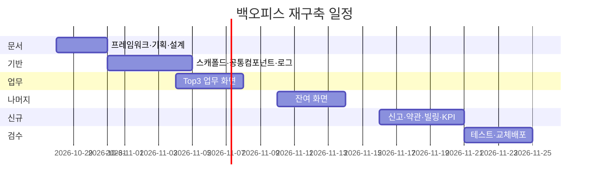

# 착수보고서

**프로젝트명**: 티업링크(teeup) 백오피스 재구축
**작성일**: 2026-10-28
**작성자**: PM (euijooning) / Claude Code
**근거 문서**: [PRD.md](../../PRD.md)

---

## 1. 프로젝트 개요

티업링크는 골프 모임(클럽·라운딩·소셜)을 운영하는 커뮤니티 앱입니다. 이 프로젝트는 그 운영자가 쓰는 **내부 관리 콘솔(백오피스)을 전면 재구축**합니다.

| 항목 | 내용 |
|------|------|
| 대상 시스템 | `TeeupLink/teeup-v2-backoffice` (프론트), `TeeupLink/teeup-v2-backend` (API 보강) |
| 현행 | Mantis(MUI) 템플릿 기반 JavaScript, 약 50화면 / 25,000줄 |
| 목표 | React + Vite + TypeScript + Tailwind, 공통 컴포넌트 기반 약 60화면 |
| 기간 | 2026-10-28 ~ 2026-11-24 (20 영업일) |
| 추진 배경 | ① 실운영(지인 대상) 시작 직전 ② 장기 목표인 대기업 인수 실사 대비 ③ 현행 백오피스는 개발자 본인도 복잡해서 사용하지 않음 |
| 일정 관리 | [GitHub Project backoffice-renew](https://github.com/orgs/TeeupLink/projects/3) (이슈 26건, 시작·마감일 지정) |

## 2. 프로젝트 목표

| 구분 | 목표 | 측정 지표 |
|------|------|-----------|
| 단기 (재구축 완료, 11/24) | 운영 업무 전부를 백오피스 안에서 처리 | 화면 이식률 100%, DB 직접 수정 0건 |
| 단기 | 화면 간 목록·폼 동작 일관성 확보 | 모든 목록이 공통 DataTable 사용 (예외 0) |
| 중기 (운영 2개월) | 운영자가 매일 쓰는 도구 | 주 5일 이상 접속, 핵심 처리 3클릭 이내 |
| 중기 | 인수 실사 대응 가능한 상태 | 감사 로그 커버리지 100% (관리자 변경 API 전부), 산출물 15종 이상 완료 |

## 3. 프로젝트 범위

### 3.1 범위 내 (In Scope)

| 영역 | 내용 |
|------|------|
| 기반 | TS·Tailwind 스캐폴드, shortcrew 레이아웃(다크 접이식 사이드바) + teeup 브랜드색, 인증(JWT+CSRF), 역할 6종 권한 |
| 공통 컴포넌트 | DataTable(URL 상태), FilterBar, Form(RHF+zod), BulkActionBar, Modal/Confirm/Toast, Empty/Loading/Error |
| 업무 화면 (Top 3 우선) | 대시보드 "오늘 처리할 일", 회원(+활동 타임라인), 클럽 가입신청 일괄 승인, 1:1 문의, 라운딩(팀·점수·경비·통계) |
| 나머지 화면 | 클럽(공지·규정·회비), 소셜(경비), 공지, FAQ, 관리자, 프로필, 설정, 알림 벨, 감사 로그 조회 |
| 신규 화면 | 신고·차단, 약관 버전·동의 이력, 결제·구독 + 빌링 샌드박스, KPI 대시보드, 개인정보 마스킹 모드 |
| 백엔드 보강 | 관리자 감사 로그, 회원 활동 로그(1년 보관), 토스 빌링(비활성 대기), 집계 API, 신고·약관 관리 API |
| 긴급 정비 | Firebase Admin 키 저장소 제거·로테이션(backend #47), 토스 조회·취소 인증 헤더 버그(backend #48) |
| 문서 | JUSTICELAB-AP-Framework V0.2 산출물 체인 (#1~#17) |

### 3.2 범위 외 (Out of Scope)

| 항목 | 사유 |
|------|------|
| RN 앱(teeup-v2-reactnative) 수정 | 별도 개발 주체. 빌링 카드 등록 UI도 앱에 넣지 않고 백오피스 샌드박스로 검증 |
| 클럽장 등 외부 사용자 접근 | 내부 운영 전용 도구 (영구 제외) |
| 다국어 | 내부 한국어 사용자만 |
| 다크모드 | 사이드바만 다크, 본문 라이트 고정 |
| 실시간 웹소켓 | 알림은 폴링으로 충분 |
| 외부 메신저 알림 (슬랙·카카오·이메일) | 헤더 알림 벨로 한정 |
| 빌링 실제 과금 | 구현 후 `BILLING_ENABLED=false`로 대기 |

## 4. 추진 일정

| 단계 | 기간 | 주요 활동 | 산출물 / 이슈 |
|------|------|-----------|---------------|
| 문서 | 10/28 ~ 10/30 | 프레임워크 적용, 기획·설계 문서, 긴급 보안·버그 정비 | #1 착수보고서, #3~#9, #12 / backoffice #14~#16, backend #46~#48 |
| 기반 | 10/31 ~ 11/04 | 스캐폴드, 레이아웃, 공통 컴포넌트, 로그 인프라 | backoffice #17·#18, backend #49·#50 |
| 업무 | 11/04 ~ 11/07 | Top 3 업무 화면 | backoffice #19~#23 |
| 나머지 | 11/10 ~ 11/13 | 잔여 운영 화면 이식 | backoffice #24~#28, #14 중간보고서 |
| 신규 | 11/16 ~ 11/20 | 신고·약관·빌링·KPI | backoffice #29~#32, backend #51 |
| 검수 | 11/21 ~ 11/24 | 테스트 시나리오·결과, 교체 배포, 완료보고 | backoffice #33, #15~#17 |

## 5. 팀 구성

| 역할 | 인원 | 담당 영역 |
|------|------|-----------|
| PM / 오너 | 1 | 의사결정, 단계별 검수, 운영 시나리오 검증 |
| 개발 (Claude Code) | - | 문서 산출물, 프론트 전체, 백엔드 보강, 테스트 |
| 앱 개발 (외부) | - | 이 프로젝트 비대상. 앱 영향이 있는 백엔드 변경은 하위 호환 유지 |

## 6. 리스크 관리

| 리스크 | 영향도 | 발생 확률 | 대응 방안 |
|--------|--------|-----------|-----------|
| 20 영업일에 60화면 — 일정 초과 | 고 | 중 | 공통 컴포넌트 선행으로 화면당 비용 절감, Top 3 우선, 단계별 확인으로 조기 발견 |
| 백엔드 API가 화면 요구(필터·일괄처리·집계)를 못 따라감 | 고 | 고 | 문서 단계에서 API 대조표 작성, 부족분은 backend 이슈로 분리해 병행 |
| 백엔드 변경이 RN 앱을 깨뜨림 | 고 | 중 | 기존 엔드포인트 응답 형식 유지, 신규는 `/admin` 하위로 추가 |
| 로그 기록이 본 요청 성능·안정성 저하 | 중 | 중 | 기록 실패가 본 요청을 깨뜨리지 않도록 격리, 인덱스 설계 |
| 저장소에 커밋된 Firebase Admin 키 | 고 | 기발생 | backend #47 — 추적 해제, 시크릿 이관, 키 로테이션 |
| 빌링 오작동으로 실제 과금 | 고 | 저 | `BILLING_ENABLED=false` 기본, 테스트 키 샌드박스로만 검증 |
| 기존 RUN-70 작업과 충돌 | 중 | 중 | `rebuild` 브랜치를 `origin/RUN-70` 최신에서 분기, 병합 시점에 dev 동기화 |

## 7. 커뮤니케이션 계획

| 활동 | 빈도 | 참석자 | 채널 |
|------|------|--------|------|
| 단계 완료 검수 | 단계별 (6회) | PM, Claude Code | Claude Code 세션 |
| 진행 상태 갱신 | 이슈 상태 변경 시 | - | GitHub Project backoffice-renew |
| 주간보고 | 주 1회 (금) | PM | docs/10.보고서/R1.주간보고/ |
| 중간보고 | 1회 (나머지 단계 종료 시) | PM | docs/10.보고서/R2.중간보고/ |
| 완료보고 | 1회 (11/24) | PM | docs/10.보고서/R3.완료보고/ |
