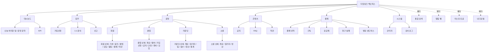
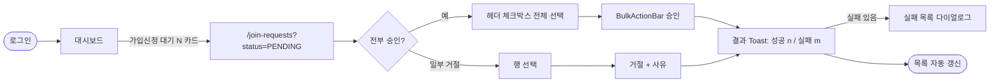
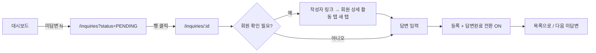
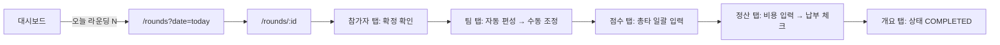
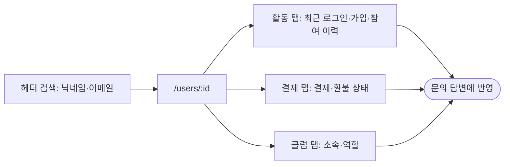
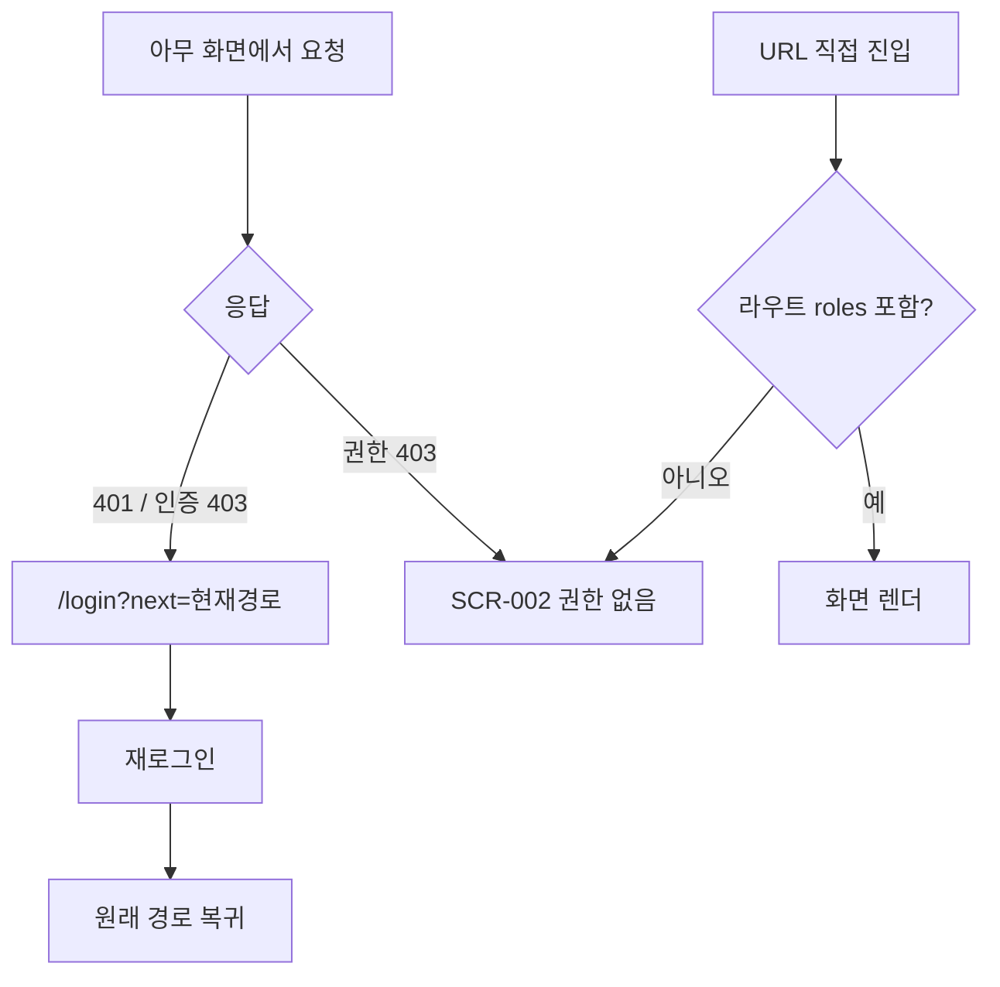
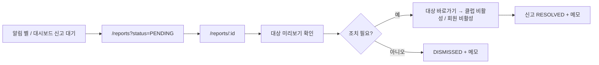

# 정보구조도 (Information Architecture)

**프로젝트명**: 티업링크 백오피스 재구축
**작성일**: 2026-10-28
**버전**: v1.0
**입력**: [기능명세서](기능명세서.md)

---

## 1. 전체 사이트맵

메뉴는 "업무 → 운영 데이터 → 콘텐츠 → 수익 → 시스템" 순서입니다. 매일 처리하는 업무(가입신청·문의·신고)를 맨 위에 둬서 대시보드를 거치지 않아도 바로 들어갈 수 있게 했습니다.

### 1.1 기존 메뉴 대비 변경

| 기존 | 재구축 | 이유 |
|------|--------|------|
| 사용자관리(회원·관리자) | 회원 → 운영, 관리자 → 시스템 | 회원은 일상 업무, 관리자는 드문 설정 |
| 클럽 상세 안의 "가입승인관리" 탭만 존재 | **업무 > 가입신청** 통합 목록 신설 (클럽 상세 탭도 유지) | 클럽별로 들어가지 않고 한 번에 처리 |
| 클럽 공지·규정·회비 = 별도 페이지 | 클럽 상세의 탭 | 화면 이동 감소 |
| 라운딩 팀·점수·정산·통계 = 별도 페이지 | 라운딩 상세의 탭 | 화면 이동 감소 |
| 시스템 > 설정(비밀번호 + 약관 4탭) | 비밀번호 → 내 프로필, 약관 → 콘텐츠 > 약관(버전 관리) | 역할 교차 문제 해소, 버전 도입 |
| 알림 페이지(localStorage) | 헤더 알림 벨만 | 범위 결정 |
| 클럽 개설 신청 2화면(고아) | 삭제 | 승인 없이 자유 등록 (2026-10-28 결정) |

---

## 2. 라우트 표

규칙(REQ-014): 목록 `/x`, 생성 `/x/new`, 상세 `/x/:id`(기본 탭), 상세 탭 `/x/:id/{tab}`, 수정 `/x/:id/edit`. 목록 상태는 쿼리스트링.

| 라우트 | 화면 ID | 화면명 | 메뉴 그룹 |
|--------|---------|--------|-----------|
| `/login` | SCR-001 | 로그인 | - |
| `/403` · `*` | SCR-002 · SCR-003 | 권한 없음 · 찾을 수 없음 | - |
| `/dashboard` | SCR-010 | 대시보드 | 대시보드 |
| `/dashboard/kpi` | SCR-011 | KPI 대시보드 | 대시보드 |
| `/join-requests` | SCR-020 | 가입신청 목록 | 업무 |
| `/inquiries` | SCR-021 | 1:1 문의 목록 | 업무 |
| `/inquiries/:id` | SCR-022 | 1:1 문의 상세 | 업무 |
| `/reports` | SCR-023 | 신고 목록 | 업무 |
| `/reports/:id` | SCR-024 | 신고 상세 | 업무 |
| `/users` | SCR-030 | 회원 목록 | 운영 |
| `/users/new` · `/users/:id/edit` | SCR-031 | 회원 등록·수정 | 운영 |
| `/users/:id[/golf\|clubs\|meetings\|activity\|payments\|terms]` | SCR-032 | 회원 상세 | 운영 |
| `/clubs` | SCR-040 | 클럽 목록 | 운영 |
| `/clubs/new` · `/clubs/:id/edit` | SCR-041 | 클럽 등록·수정 | 운영 |
| `/clubs/:id[/members\|join-requests\|notices\|regulations\|fees\|meetings]` | SCR-042 | 클럽 상세 | 운영 |
| `/clubs/:id/notices/new` · `/clubs/:id/notices/:nid/edit` | SCR-043 | 클럽 공지 작성·수정 | 운영 |
| `/clubs/:id/regulations/new` · `/clubs/:id/regulations/:rid/edit` | SCR-044 | 클럽 규정 작성·수정 | 운영 |
| `/rounds` | SCR-050 | 라운딩 목록 | 운영 |
| `/rounds/new` · `/rounds/:id/edit` | SCR-051 | 라운딩 등록·수정 | 운영 |
| `/rounds/:id[/participants\|teams\|scores\|settlement\|stats]` | SCR-052 | 라운딩 상세 | 운영 |
| `/socials` | SCR-060 | 소셜 목록 | 운영 |
| `/socials/new` · `/socials/:id/edit` | SCR-061 | 소셜 등록·수정 | 운영 |
| `/socials/:id[/participants\|settlement]` | SCR-062 | 소셜 상세 | 운영 |
| `/notices` | SCR-070 | 공지 목록 | 콘텐츠 |
| `/notices/new` · `/notices/:id/edit` | SCR-071 | 공지 작성·수정 | 콘텐츠 |
| `/notices/:id` | SCR-072 | 공지 상세 | 콘텐츠 |
| `/faq` | SCR-073 | FAQ 목록 (+카테고리 관리 모달) | 콘텐츠 |
| `/faq/new` · `/faq/:id/edit` | SCR-074 | FAQ 작성·수정 | 콘텐츠 |
| `/terms` | SCR-075 | 약관 (유형 탭 + 버전 목록) | 콘텐츠 |
| `/terms/new` · `/terms/:id` | SCR-076 | 약관 버전 작성 · 버전 상세(동의 이력) | 콘텐츠 |
| `/payments` | SCR-080 | 결제 내역 | 결제 |
| `/payments/:id` | SCR-081 | 결제 상세 (취소·환불) | 결제 |
| `/subscriptions` | SCR-082 | 구독 목록 | 결제 |
| `/subscriptions/:id` | SCR-083 | 구독 상세 | 결제 |
| `/plans` | SCR-084 | 요금제 (목록 + 모달 폼) | 결제 |
| `/billing/failures` | SCR-085 | 청구 실패 | 결제 |
| `/billing/sandbox` | SCR-086 | 빌링 샌드박스 | 결제 |
| `/admins` | SCR-090 | 관리자 목록 | 시스템 |
| `/admins/new` · `/admins/:id/edit` | SCR-091 | 관리자 등록·수정 | 시스템 |
| `/admins/:id` | SCR-092 | 관리자 상세 (+비밀번호 재설정) | 시스템 |
| `/audit-logs` | SCR-093 | 감사 로그 (목록 + 상세 드로어) | 시스템 |
| `/audit-logs/monthly` | SCR-094 | 월간 점검 | 시스템 |
| `/profile` | SCR-095 | 내 프로필 (비밀번호 변경 포함) | 헤더 |

화면 ID는 44개입니다. 상세의 탭은 같은 화면 ID 안에서 관리하고, 탭·모달·드로어는 화면설계서에서 `SCR-xxx-Tn` / `-Mn` / `-Dn`으로 세분합니다. 기존 약 50화면 중 별도 페이지였던 클럽 공지·규정·회비, 라운딩 팀·점수·정산·통계, 소셜 정산이 탭으로 흡수되어 화면 ID 수가 줄었습니다.

---

## 3. 권한 매트릭스

`R`=조회, `W`=조회+변경, `-`=메뉴 숨김·라우트 403. SUPER_ADMIN은 전 항목 `W`. 이 표가 프론트 라우트 메타·메뉴·대시보드 카드와 백엔드 `require_roles`의 **단일 기준**입니다.

| 메뉴 / 화면 | CLUB | MEETING | USER | CONTENT | SUPPORT | 백엔드 변경 필요 |
|-------------|------|---------|------|---------|---------|------------------|
| 대시보드(오늘 할 일·요약) | R | R | R | R | R | 카드별 범위 필터 |
| KPI | - | - | - | - | - | SUPER 전용 |
| 가입신청 | W | - | - | - | - | 신설 |
| 1:1 문의 | - | - | - | - | W | |
| 신고 | - | - | - | - | W | 신설 |
| 회원 | - | - | W | - | R | **SUPPORT 조회 추가** (CS 응대 시 회원 확인) |
| 클럽 | W | R | - | - | - | MEETING 조회는 lookup으로 충분하면 생략 |
| 라운딩 · 소셜 | R | W | - | - | - | CLUB 조회 = 클럽 상세 모임 탭 |
| 공지 · FAQ · 약관 | - | - | - | W | - | |
| 결제 · 구독 · 요금제 · 청구 실패 | - | - | - | - | R | **SUPPORT 결제 조회 추가** (환불 문의). 취소·환불은 SUPER |
| 빌링 샌드박스 | - | - | - | - | - | SUPER 전용 |
| 관리자 | - | - | - | - | - | SUPER 전용 |
| 감사 로그 | - | - | - | - | - | SUPER 전용 |
| 내 프로필 · 비밀번호 | W | W | W | W | W | 기존 인증만 |
| 공용 조회(lookup) | R | R | R | R | R | 신설 |
| 헤더 검색 | 범위 내 | 범위 내 | 범위 내 | 범위 내 | 범위 내 | 결과를 위 표로 필터 |

> 표에서 **굵게** 표시한 SUPPORT 조회 권한 2건은 기존에 없던 것입니다. CS 담당이 문의에 답하려면 회원·결제를 봐야 하므로 추가를 제안합니다. 조회는 감사 로그(VIEW_PII)로 남습니다.

---

## 4. 사용자 흐름

### 4.1 가입신청 일괄 승인 (Top 1 업무)

클릭 수: 카드 1 → 전체 선택 2 → 승인 3 (확인 다이얼로그는 승인에는 띄우지 않고 거절에만 띄웁니다).

### 4.2 1:1 문의 답변 (Top 2 업무)

상세 화면에 "다음 미답변" 버튼을 둬서 목록으로 돌아가지 않고 연속 처리합니다.

### 4.3 오늘 라운딩 운영 (Top 3 업무)

### 4.4 회원 문의 대응 (DB 직접 조회 제거)

### 4.5 세션 만료·권한

### 4.6 신고 처리

---

## 5. 화면 간 공통 이동 규칙

| 상황 | 이동 |
|------|------|
| 목록 행 클릭 | 상세 (Ctrl/Cmd 클릭 = 새 탭 — 행은 `<a>`로 렌더) |
| 등록 완료 | 생성된 상세 |
| 수정 완료 | 상세 (탭 유지) |
| 삭제 완료 | 목록 (이전 필터 유지 — 목록 URL을 상세 진입 시 `state`에 보관) |
| 상세 "목록으로" | 진입했던 목록 URL (없으면 기본 목록) |
| 다른 도메인 참조 (클럽명·회원명 등) | 해당 상세 링크. 권한 없으면 링크 대신 텍스트 |
| 대시보드 카드 | 필터가 걸린 목록 |
