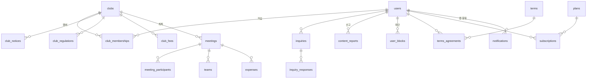
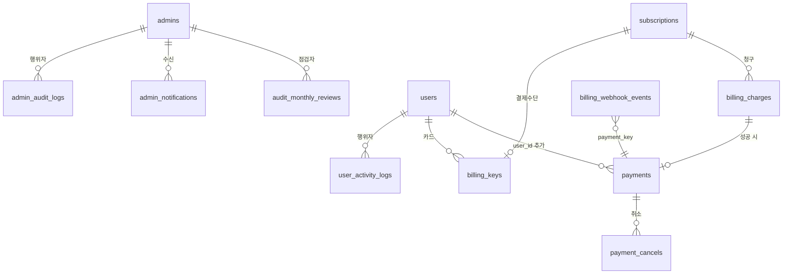

# 데이터베이스 설계서

**프로젝트명**: 티업링크 백오피스 재구축
**작성일**: 2026-10-28
**버전**: v1.0
**입력**: [기능명세서](../02.기획문서/기능명세서.md), [API스펙](../02.기획문서/API스펙.md), `teeup-v2-backend/models/*.py` (origin/dev 기준)
**대상 DB**: MySQL (SQLAlchemy ORM, PyMySQL)

---

## 1. 설계 전제

| 항목 | 내용 |
|------|------|
| 스키마 관리 | 마이그레이션 도구 없음. 서버 기동 시 `Base.metadata.create_all()` — **없는 테이블만 생성, 기존 테이블에 컬럼을 추가하지 않음** |
| 컬럼 추가 | `scripts/*.sql`의 `ALTER TABLE … ADD COLUMN`을 배포 전에 수동 실행. `scripts/check_schema_drift.py`로 누락 검사 |
| 설계 원칙 | ① 새 기능은 **새 테이블**로 (create_all이 자동 생성 → 배포 위험 최소) ② 기존 테이블 변경은 NULL 허용 컬럼 추가만 ③ 기존 enum 값 추가·변경 금지 (앱 영향, MySQL ENUM ALTER 필요) ④ 앱 API 응답 스키마 불변 |
| PK | `INT AUTO_INCREMENT` (기존 관례). 로그 테이블만 `BIGINT` |
| 시각 | `DATETIME`, KST 저장 (`utils.datetime_utils.get_kst_now`, 기존 관례) |
| 문자셋 | utf8mb4 |

---

## 2. 기존 스키마에서 발견한 제약 (설계에 반영)

| # | 사실 | 영향 | 대응 |
|---|------|------|------|
| 1 | 가입신청 거절 시 `club_memberships` 행을 **삭제**함 (`routers/admin/clubs.py` reject) | 거절 이력이 남지 않음 | 거절·승인 이력은 감사 로그(`admin_audit_logs`, target `CLUB_MEMBERSHIP`)에서 조회. MembershipStatus에 REJECTED 추가하지 않음(앱 영향) |
| 2 | 관리자 알림 API가 `notifications.user_id == 관리자 id`로 조회 — `notifications.user_id`는 `users.id` FK | **관리자 1번에게 회원 1번의 알림이 보임** (id 공간 충돌) | 관리자 전용 `admin_notifications` 신설, 기존 `/admin/notifications`를 새 테이블로 전환 |
| 3 | `payments`에 `user_id` 없음 (`customer_key` 문자열만), 취소 금액·이력 없음 | 회원별 결제 조회·부분 환불 불가 | `payments.user_id` NULL 컬럼 추가 + `payment_cancels` 신설 |
| 4 | `terms`에 버전 번호 없음 (`title`, `is_active`, `published_at`만) | 버전 목록·초안 구분 불가 | `terms.version`, `terms.effective_at` NULL 컬럼 추가. 초안 = `published_at IS NULL` |
| 5 | `admins.role` 기본값 SUPER_ADMIN, 코드에서 role null → SUPER 간주 | 권한 상승 위험 | 코드 수정(BE#46). 데이터: role null 행 점검 SQL 제공 |
| 6 | `plans.price` DECIMAL, `payments.amount` INT | KRW 정수 처리 혼재 | 신규 테이블은 INT(원). plans는 그대로 두고 API에서 정수 변환 |
| 7 | 상태 문자열이 Enum이 아닌 `String(50)`인 테이블 존재 (payments, subscriptions) | 값 검증 부재 | 신규 코드에서 enum 상수로 검증, DB 타입은 유지 |

---

## 3. ERD

### 3.1 기존 핵심 (백오피스가 쓰는 범위)



### 3.2 신설·변경



---

## 4. 신설 테이블

### 4.1 admin_audit_logs — 관리자 감사 로그 (BE#49)

개인정보 안전성 확보조치 기준 제8조(접속기록) 대응. **INSERT 전용**.

| 컬럼 | 타입 | NULL | 설명 |
|------|------|------|------|
| id | BIGINT PK AI | N | |
| request_id | CHAR(36) | N | 요청 단위 UUID. 일괄 처리 건별 행을 묶음 |
| actor_admin_id | INT | Y | FK admins.id (ON DELETE SET NULL). 로그인 실패 시 NULL |
| actor_email | VARCHAR(255) | N | 삭제된 관리자도 식별되도록 스냅샷 |
| actor_role | VARCHAR(30) | Y | 행위 시점 역할 스냅샷 |
| action | VARCHAR(30) | N | CREATE·UPDATE·DELETE·STATUS_CHANGE·APPROVE·REJECT·BULK·VIEW_PII·EXPORT·LOGIN·LOGOUT·LOGIN_FAIL·PASSWORD_RESET·REVIEW |
| target_type | VARCHAR(40) | Y | USER·ADMIN·CLUB·CLUB_MEMBERSHIP·CLUB_NOTICE·REGULATION·FEE·MEETING·TEAM·SCORE·EXPENSE·NOTICE·FAQ·TERMS·INQUIRY·REPORT·PLAN·SUBSCRIPTION·PAYMENT·BILLING·AUDIT |
| target_id | VARCHAR(64) | Y | 문자열(복합키·paymentKey 수용) |
| before_json | JSON | Y | 변경 전 (민감 필드 제거) |
| after_json | JSON | Y | 변경 후 (민감 필드 제거) |
| reason | VARCHAR(500) | Y | 사유 (삭제·거절·상태변경·내보내기) |
| meta_json | JSON | Y | 부가 정보 (EXPORT 건수·필터, BULK 원 요청) |
| method | VARCHAR(10) | N | HTTP 메서드 |
| path | VARCHAR(255) | N | 요청 경로 (쿼리 제외) |
| status_code | SMALLINT | N | 응답 코드 |
| result | VARCHAR(10) | N | SUCCESS·FAIL |
| ip | VARCHAR(45) | N | X-Forwarded-For 첫 값 (nginx 신뢰) |
| user_agent | VARCHAR(500) | Y | |
| created_at | DATETIME(3) | N | |

| 인덱스 | 컬럼 | 용도 |
|--------|------|------|
| ix_audit_created | (created_at) | 기간 조회, 보관 정리 |
| ix_audit_actor_created | (actor_admin_id, created_at) | 관리자별, 월간 점검 |
| ix_audit_target | (target_type, target_id) | 대상 이력 (가입신청 처리 이력 포함) |
| ix_audit_action_created | (action, created_at) | VIEW_PII·EXPORT 집계 |
| ix_audit_request | (request_id) | 일괄 묶음 |

**위·변조 방지**

| 수단 | 내용 |
|------|------|
| API | 수정·삭제 엔드포인트 없음 |
| 애플리케이션 | ORM 모델에 `before_update`/`before_delete` 이벤트로 예외 발생 |
| DB 권한 (운영 적용 권고) | 앱 DB 계정에서 이 테이블 `UPDATE`, `DELETE` 권한 회수: `REVOKE UPDATE, DELETE ON teeup.admin_audit_logs FROM 'app'@'%'` — 보관 정리는 별도 계정의 배치로 |
| 보관 | 최소 1년 (실사 대비 2년 권고). 정리 배치는 2년 경과분만 |

**민감 필드 제거 목록**: `password`, `hashed_password`, `token`, `access_token`, `refresh_token`, `billing_key`, `secret`, `card_number` (키 이름 부분 일치, 재귀).

### 4.2 user_activity_logs — 회원 활동 로그 (BE#50)

| 컬럼 | 타입 | NULL | 설명 |
|------|------|------|------|
| id | BIGINT PK AI | N | |
| user_id | INT | N | FK users.id (ON DELETE CASCADE) |
| event_type | VARCHAR(40) | N | SIGNUP·WITHDRAW·LOGIN·PROFILE_UPDATE·CLUB_JOIN_REQUEST·CLUB_JOIN·CLUB_LEAVE·MEETING_JOIN·MEETING_CANCEL·PAYMENT·REPORT |
| target_type | VARCHAR(30) | Y | CLUB·MEETING·PAYMENT·REPORT·USER |
| target_id | INT | Y | |
| summary | VARCHAR(255) | N | 표시용 요약 ("강남 골프회 가입신청") — 대상이 삭제돼도 의미 유지 |
| meta_json | JSON | Y | device(ios/android/web), app_version, provider 등 |
| ip | VARCHAR(45) | Y | |
| created_at | DATETIME | N | |

| 인덱스 | 컬럼 | 용도 |
|--------|------|------|
| ix_act_user_created | (user_id, created_at) | 회원 타임라인 (커서 = created_at, id) |
| ix_act_created | (created_at) | 1년 경과 정리, KPI 집계 |
| ix_act_type_created | (event_type, created_at) | DAU·MAU (LOGIN) |

보관: 1년. 일일 배치 `DELETE … WHERE created_at < NOW() - INTERVAL 1 YEAR LIMIT 5000` 반복.

### 4.3 admin_notifications — 관리자 알림 (BE#46)

| 컬럼 | 타입 | NULL | 설명 |
|------|------|------|------|
| id | INT PK AI | N | |
| admin_id | INT | Y | FK admins.id. NULL = 역할 대상 알림 |
| target_role | VARCHAR(30) | Y | 역할 대상 (예: CLUB_ADMIN → SUPER·CLUB 모두 수신) |
| type | VARCHAR(40) | N | JOIN_REQUEST·INQUIRY·REPORT·BILLING_FAILURE·SYSTEM |
| title | VARCHAR(255) | N | |
| link | VARCHAR(255) | Y | 백오피스 경로 (`/inquiries/12`) |
| created_at | DATETIME | N | |

읽음은 별도 `admin_notification_reads(notification_id, admin_id, read_at)` PK(notification_id, admin_id) — 역할 대상 알림을 관리자별로 읽음 처리하기 위함. 보관 90일.

### 4.4 billing_keys — 빌링키 (BE#51)

| 컬럼 | 타입 | NULL | 설명 |
|------|------|------|------|
| id | INT PK AI | N | |
| user_id | INT | N | FK users.id |
| customer_key | VARCHAR(64) | N | 토스 customerKey (UUID, 회원별 고정) |
| billing_key_enc | VARBINARY(512) | N | **암호화 저장** (AES-GCM, 키는 환경변수 `BILLING_KEY_ENC_KEY`) |
| card_company | VARCHAR(30) | Y | |
| card_number_masked | VARCHAR(30) | Y | 토스 응답의 마스킹 번호 |
| status | VARCHAR(20) | N | ACTIVE·REVOKED |
| mode | VARCHAR(10) | N | TEST·LIVE (발급 키 종류) |
| created_at / revoked_at | DATETIME | N / Y | |

UNIQUE (customer_key, status='ACTIVE')는 MySQL 부분 유니크가 없으므로 서비스 계층에서 보장.

### 4.5 billing_charges — 정기 청구 (BE#51)

| 컬럼 | 타입 | NULL | 설명 |
|------|------|------|------|
| id | INT PK AI | N | |
| subscription_id | INT | N | FK subscriptions.id |
| billing_key_id | INT | N | FK billing_keys.id |
| period_start / period_end | DATE | N | 청구 대상 기간 |
| amount | INT | N | 원 |
| order_id | VARCHAR(64) | N | UNIQUE. `sub{구독id}_{YYYYMMDD}` |
| idempotency_key | VARCHAR(64) | N | UNIQUE. 재시도 시 동일 키 재사용 금지 — 시도마다 `order_id:시도번호` |
| attempt | TINYINT | N | 1~4 (최초 + 재시도 3회) |
| status | VARCHAR(20) | N | PENDING·SUCCEEDED·FAILED·GAVE_UP |
| failure_code / failure_message | VARCHAR(100) / VARCHAR(500) | Y | 토스 오류 |
| next_retry_at | DATETIME | Y | 1·3·7일 후 |
| payment_id | INT | Y | FK payments.id (성공 시) |
| created_at / updated_at | DATETIME | N | |

인덱스: (status, next_retry_at) 재시도 배치, (subscription_id, period_start) UNIQUE — 같은 기간 이중 청구 방지.

### 4.6 payment_cancels — 결제 취소 이력

| 컬럼 | 타입 | NULL | 설명 |
|------|------|------|------|
| id | INT PK AI | N | |
| payment_id | INT | N | FK payments.id |
| cancel_amount | INT | N | |
| cancel_reason | VARCHAR(200) | N | |
| transaction_key | VARCHAR(64) | Y | 토스 취소 거래 키 |
| canceled_by_admin_id | INT | Y | FK admins.id |
| created_at | DATETIME | N | |

결제의 잔액 = `payments.amount - SUM(cancel_amount)`. 상태 표시(완료·부분취소·취소)는 이 합으로 계산.

### 4.7 billing_webhook_events — 웹훅 수신 기록

| 컬럼 | 타입 | 설명 |
|------|------|------|
| id | INT PK AI | |
| event_type | VARCHAR(50) | PAYMENT_STATUS_CHANGED 등 |
| payment_key / order_id | VARCHAR(255) | |
| payload_json | JSON | 원문 |
| verified | BOOLEAN | 토스 조회 API로 재확인 결과 일치 여부 |
| processed_at | DATETIME NULL | 중복 수신 시 skip |
| created_at | DATETIME | |

### 4.8 audit_monthly_reviews — 월간 점검 기록

| 컬럼 | 타입 | 설명 |
|------|------|------|
| id | INT PK AI | |
| month | CHAR(7) | `2026-11`, UNIQUE |
| reviewer_admin_id | INT | FK admins.id |
| summary_json | JSON | 점검 시점 집계 스냅샷 |
| memo | TEXT NULL | |
| reviewed_at | DATETIME | |

---

## 5. 기존 테이블 변경 (ADD COLUMN만)

배포 전 `scripts/` 에 SQL 파일로 추가하고 수동 실행합니다. 전부 NULL 허용 또는 기본값이 있어 기존 행·앱에 영향이 없습니다.

| 테이블 | 컬럼 | 타입 | 이유 | 스크립트 |
|--------|------|------|------|----------|
| payments | user_id | INT NULL, FK users.id, INDEX | 회원별 결제 조회 | `add_payment_user_id.sql` (+ customer_key로 역매핑 가능한 기존 행 채우기) |
| terms | version | VARCHAR(20) NULL | 버전 표시 (`v2.1`) | `add_terms_version.sql` (기존 행 `v1`) |
| terms | effective_at | DATETIME NULL | 시행일 | 동일 |
| subscriptions | billing_key_id | INT NULL, FK billing_keys.id | 구독 결제수단 | `add_subscription_billing_key.sql` |
| subscriptions | canceled_at, cancel_reason | DATETIME NULL, VARCHAR(200) NULL | 해지 기록 | 동일 |

**인덱스 추가 (조회 성능, 데이터 변경 없음)**

| 테이블 | 인덱스 | 용도 |
|--------|--------|------|
| club_memberships | (status, created_at) | 가입신청 통합 목록 |
| inquiries | (status, created_at) | 미답변 목록·대시보드 |
| content_reports | (status, created_at), (target_type, target_id) | 신고 목록·누적 수 |
| meetings | (meeting_type, meeting_time) | 오늘·기간 필터 (모임일 = `meeting_time`) |
| users | (created_at) | 가입일 정렬·KPI |

---

## 6. 상태값 매핑 (화면 ↔ DB)

화면 라벨은 프론트 `lib/status.ts` 한 곳에서만 정의합니다.

| 도메인 | DB 값 | 화면 라벨 | 비고 |
|--------|-------|-----------|------|
| 가입신청 | `club_memberships.status = PENDING` | 대기 | 승인 = ACTIVE 전환, 거절 = 행 삭제. 처리 이력 탭은 감사 로그 기반 |
| 문의 | PENDING, SUBMITTED | 미답변 | 탭 "미답변" = 두 값 IN |
| | IN_PROGRESS | 처리중 | |
| | RESOLVED, COMPLETED | 답변완료 | 답변 등록 시 전환값은 COMPLETED |
| | CLOSED | 종료 | |
| 참가자 | PENDING / CONFIRMED / WAITING_LIST / CANCELED | 신청 / 확정 / 대기 / 취소 | |
| 결제 | SUCCEEDED (+취소 합) | 완료 / 부분취소 / 취소 | 취소 여부는 payment_cancels 합으로 계산 |
| | PENDING / FAILED | 대기 / 실패 | |
| 약관 | published_at NULL | 초안 | |
| | is_active = 1 | 게시중 | 유형별 1개 |
| | published_at NOT NULL, is_active = 0 | 지난 버전 | |
| 약관 유형 | SERVICE / PRIVACY / PRIVACY_COLLECTION / MARKETING | 서비스 이용약관 / 개인정보 처리방침 / 수집·이용 동의 / 마케팅 수신 | |
| 회원 | ACTIVE / DEACTIVATED / DELETED | 활성 / 비활성 / 탈퇴 | |

---

## 7. 초기 데이터·점검 SQL

```sql
-- role 이 비어 있는 관리자 (BE#46 배포 전 확인 — 코드 수정 후 이 계정들은 403)
SELECT id, email, role, status FROM admins WHERE role IS NULL;

-- 기존 약관 버전 채우기 (add_terms_version.sql 안에 포함)
UPDATE terms SET version = 'v1' WHERE version IS NULL;
```

## 8. 마이그레이션 절차 (배포 시)

| 순서 | 작업 | 담당 |
|------|------|------|
| 1 | `scripts/add_*.sql` 실행 (ADD COLUMN, 인덱스) | 배포자 |
| 2 | `check_schema_drift.py`로 누락 0 확인 | 배포자 |
| 3 | 백엔드 재기동 → `create_all`이 신설 테이블 생성 | 자동 |
| 4 | (권고) 감사 로그 테이블 UPDATE·DELETE 권한 회수 | 배포자 |
| 5 | `BILLING_ENABLED=false` 확인 | 배포자 |
