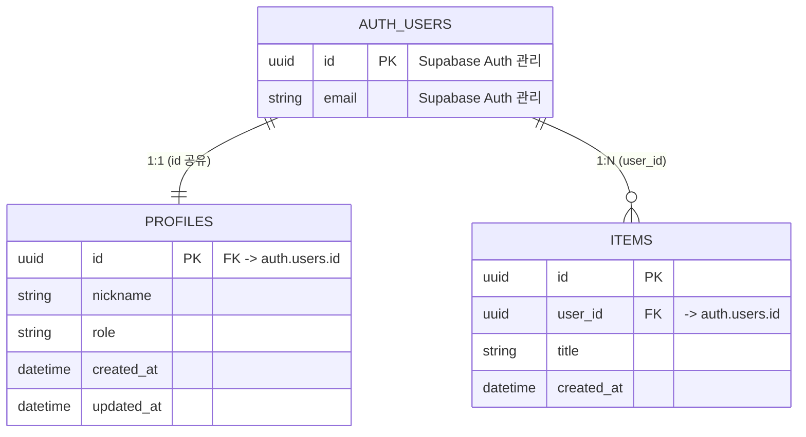

# 데이터베이스 설계서

> 데이터베이스의 논리적/물리적 구조를 정의한다.
> 표준 DB: **PostgreSQL (Supabase)** · 인증: **Supabase Auth** (자체 JWT 미발급)

## 설계 전제 (Supabase Auth 기준)

| 구분 | 소유 | 설명 |
|------|------|------|
| `auth.users` | **Supabase** | 이메일·비밀번호·소셜 로그인·세션을 Supabase Auth가 관리. 앱이 직접 수정하지 않는다 |
| `public.profiles` | 앱 | 서비스에 필요한 사용자 정보(닉네임, 권한, 프로필 이미지 등). `auth.users.id`를 PK로 공유 |
| `public.*` | 앱 | 그 외 업무 테이블. 사용자 소유 데이터는 `user_id UUID -> auth.users(id)`로 참조 |

> **앱 테이블에 비밀번호 컬럼을 두지 않는다.** 비밀번호 해시는 `auth.users`가 보관하며, 백엔드는 Supabase가 발급한 토큰을 `SUPABASE_JWT_SECRET`으로 검증만 한다.
> **사용자 PK는 `SERIAL`이 아니라 `UUID`다.** `auth.users.id`가 UUID이므로 `SERIAL`로 잡으면 조인이 성립하지 않는다.
> 이메일·전화번호 등 `auth.users`가 이미 가진 값은 앱 테이블에 중복 저장하지 않는다. 표시 목적으로 꼭 필요하면 동기화 책임자를 명시한다.

## ERD (Entity-Relationship Diagram)



## 테이블 정의

### profiles (사용자 프로필 — `auth.users` 1:1 확장)

| 컬럼명 | 타입 | 제약조건 | 기본값 | 설명 |
|--------|------|----------|--------|------|
| id | UUID | PK, FK -> `auth.users(id)` ON DELETE CASCADE | - | 사용자 ID (`auth.users.id`와 동일 값) |
| nickname | VARCHAR(50) | NOT NULL | - | 서비스 표시명 |
| role | VARCHAR(20) | NOT NULL | 'user' | 권한 (`user` / `admin`) |
| avatar_url | TEXT | NULL | - | 프로필 이미지 (Supabase Storage 경로) |
| created_at | TIMESTAMPTZ | NOT NULL | NOW() | 생성일시 |
| updated_at | TIMESTAMPTZ | NOT NULL | NOW() | 수정일시 |

> 회원 탈퇴 시 `auth.users` 행이 삭제되면 `ON DELETE CASCADE`로 프로필도 함께 지워진다.
> 시각 컬럼은 `TIMESTAMP`가 아니라 **`TIMESTAMPTZ`** 를 쓴다. Cloud Run·Supabase·브라우저의 타임존이 서로 달라 `TIMESTAMP`는 기준 시점을 잃는다.

### [테이블명] (사용자 소유 업무 테이블 예시)

| 컬럼명 | 타입 | 제약조건 | 기본값 | 설명 |
|--------|------|----------|--------|------|
| id | UUID | PK | `gen_random_uuid()` | 레코드 ID |
| user_id | UUID | FK -> `auth.users(id)` ON DELETE CASCADE, NOT NULL | - | 소유자 |
| | | | | |

## 인덱스 정의

| 테이블 | 인덱스명 | 컬럼 | 유형 | 목적 |
|--------|----------|------|------|------|
| profiles | idx_profiles_nickname | nickname | UNIQUE | 표시명 중복 방지 (서비스 정책에 따라 선택) |
| [테이블명] | idx_[테이블]_user_id | user_id | INDEX | 소유자별 목록 조회 |

> 로그인 조회용 이메일 인덱스는 만들지 않는다. 이메일은 `auth.users`가 소유하며 인증 조회도 Supabase가 처리한다.
> PostgreSQL은 **FK 컬럼에 인덱스를 자동 생성하지 않는다.** 조인·목록 조회에 쓰는 FK 컬럼은 직접 인덱스를 만든다.

## 관계 정의

| 부모 테이블 | 자식 테이블 | 관계 | FK 컬럼 | 설명 |
|-------------|-------------|------|---------|------|
| `auth.users` | `profiles` | 1:1 | `profiles.id` | 가입 시 자동 생성 (아래 트리거) |
| `auth.users` | [테이블명] | 1:N | `user_id` | 사용자 소유 데이터 |

## RLS (Row Level Security)

Supabase는 프론트엔드에 `anon` 키가 그대로 내려가므로, **RLS가 켜져 있지 않은 테이블은 공개 테이블과 같다.**

| 대상 | 정책 |
|------|------|
| `public` 스키마 전체 테이블 | **RLS 활성화 필수** (기본 거부) |
| 프론트가 직접 읽는 테이블 | 본인 행만 허용하는 SELECT 정책 (`auth.uid() = user_id`) |
| 데이터 조회·변경 | FastAPI 경유. 백엔드는 `service_role` 키를 사용하며 **RLS를 우회**한다 |

```sql
-- 테이블 생성 직후 반드시 실행
alter table public.profiles enable row level security;

-- 본인 프로필만 조회/수정
create policy "본인 프로필 조회" on public.profiles
  for select using (auth.uid() = id);
create policy "본인 프로필 수정" on public.profiles
  for update using (auth.uid() = id);
```

> **`service_role`은 RLS를 우회하므로, RLS만으로 권한을 설계하면 백엔드 경로에는 아무 통제가 걸리지 않는다.** 권한 검증은 FastAPI에서 토큰의 사용자·역할을 확인하는 것이 1차, RLS는 프론트 직접 접근에 대한 2차 방어선이다.
> `service_role` 키는 서버 전용이다. 프론트 번들(`VITE_*`)에 절대 넣지 않는다.

## 트리거 / 함수

| 이름 | 대상 | 시점 | 용도 |
|------|------|------|------|
| `handle_new_user` | `auth.users` | AFTER INSERT | 가입 시 `profiles` 행 자동 생성 |
| `set_updated_at` | 각 테이블 | BEFORE UPDATE | `updated_at` 자동 갱신 |

```sql
-- 가입 시 프로필 자동 생성 (Supabase 표준 패턴)
create function public.handle_new_user()
returns trigger language plpgsql security definer set search_path = '' as $$
begin
  insert into public.profiles (id, nickname)
  values (new.id, coalesce(new.raw_user_meta_data->>'nickname', split_part(new.email, '@', 1)));
  return new;
end;
$$;

create trigger on_auth_user_created
  after insert on auth.users
  for each row execute function public.handle_new_user();
```

> 프로필을 백엔드 가입 API에서 만들면 소셜 로그인(Supabase가 직접 처리하는 경로)으로 가입한 사용자에게는 프로필이 생기지 않는다. 그래서 앱 코드가 아니라 **DB 트리거**에 둔다.

## 초기 데이터

| 테이블 | 데이터 | 용도 |
|--------|--------|------|
| profiles | 관리자 계정 1건 (`role = 'admin'`) | 백오피스 최초 접근. Supabase 대시보드에서 사용자를 만든 뒤 `role`만 승격 |
| [테이블명] | [데이터 설명] | [용도] |

## 마이그레이션 관리

| 항목 | 내용 |
|------|------|
| 적용 방식 | 프로젝트 초기 세팅(P-101)에서 확정 — Supabase SQL Editor 수동 적용 / 마이그레이션 도구 중 택1 |
| 원칙 | 스키마 변경은 SQL 파일로 저장소에 남긴다. 대시보드에서만 바꾸면 재현이 불가능하다 |
| 순서 | 테이블 생성 -> RLS 활성화 -> 정책 -> 인덱스 -> 트리거 -> 초기 데이터 |
